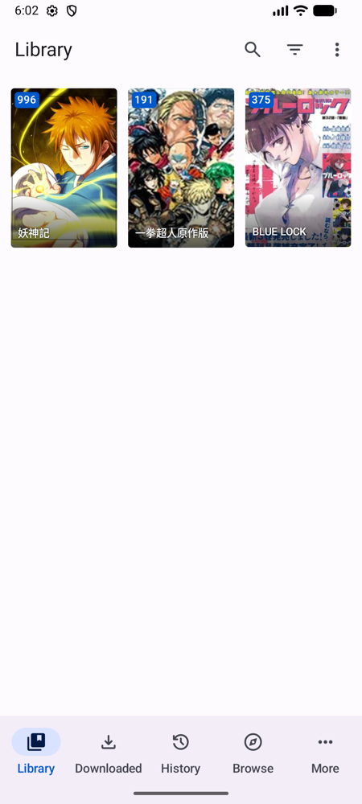

# 一漫


一漫是 Android 漫畫閱讀器，基於 [Mihon](https://github.com/mihonapp/mihon) 開發。

從 [GitHub Releases](https://github.com/freezingyip/yiman/releases) 下載已簽署的 APK。

## App 截圖

<p>
  
  
</p>

## 功能

- 本機書架、閱讀進度與歷史記錄。
- 全域搜尋已啟用的漫畫來源。
- 手動下載章節及管理已下載內容，以便離線閱讀。
- 支援橫向翻頁、雙頁和上下捲動等閱讀方式。
- 更新書架以檢查漫畫章節。

支援 Android 8.0（API 26）及以上版本。來源的可用性取決於各來源網站。

## Android 8.0 的 WebView

一漫使用系統的 WebView 來顯示 App 內的網站與驗證頁。Android 8.0／8.1 裝置若遇到驗證頁空白或打不開，可先在系統的「開發人員選項 → WebView 實作」確認目前使用的是 Android System WebView 還是 Chrome，並在 Google Play 更新該元件至裝置支援的版本。若元件已停用，請先在系統的應用程式設定重新啟用，再重開一漫試一次。[Android 官方說明](https://developer.android.com/about/versions/nougat/android-7.0#webview)

## 建置

使用 Android Studio 開啟本目錄，安裝專案所需的 Android SDK 和 JDK，再執行：

```sh
./gradlew :app:assembleDebug
```

測試版 APK 位於 `app/build/outputs/apk/debug/`。已簽署的公開版本可在 [GitHub Releases](https://github.com/freezingyip/yiman/releases) 下載。在支援自動更新的一漫版本中，App 會在使用期間向 GitHub 檢查新版並下載適用的 APK。可在「其他 → 關於 → 自動更新 App」關閉，也可在同一頁手動檢查。若 Android 要求授權或確認安裝，請按畫面指示操作。

公開版可與原有的測試版並存。若要轉移書架和閱讀記錄，先在測試版的「資料與儲存空間」建立備份，再在公開版還原。備份檔不包含已下載的漫畫圖片。

## 開源與授權

一漫使用 [Apache License 2.0](LICENSE)。本專案基於 Mihon，感謝 Mihon 及其上游專案與所有貢獻者。

上游版權：Copyright © 2015 Javier Tomás；Copyright © 2024 Mihon Open Source Project。第三方開源授權可在應用程式的「關於」頁面查看。
